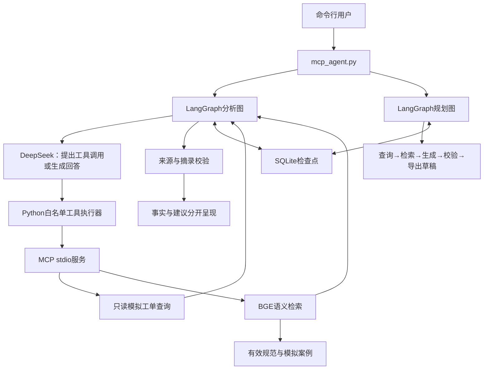

# 故障工单分析与测试任务规划 Agent

面向IT故障初步处理的个人工程实践：读取工单，检索带版本的处理规范，区分记录事实与待确认原因，再输出有来源的检查建议或待审核的测试任务草稿。

项目重点是完整任务、工具边界、状态恢复和可核验的评测记录。工单和规范均为模拟数据；尚未接入企业工单系统或生产环境。

快速查看：[评测记录](EVALUATION_RESULTS.md) · [修正闭环](docs/BADCASES.md) · [实际输出示例JSON](examples/evaluation-summary.json) · [HTML展示（下载后本地打开）](examples/report.html)

## 可以解决什么问题

故障描述分散、编号经常补充或纠正、处理规范更新后旧回答可能过期。这个原型尝试把“查工单→查规范→整理建议→起草验证任务”连起来，保留过程和失败记录，供处理人员审核。

潜在价值是减少反复查询和整理草稿的工作；目前没有真实用户对照实验，不声明节省工时、降低成本或企业落地效果。

## 演示路径

启动后输入：

```text
分析 TK-002：先查询当前工单，再根据完整故障描述检索知识库，给出带来源的检查建议。
刚才编号说错了，改为分析 TK-001。重新查询，不沿用上一张工单的结论。
/plan TK-002
/status
exit
```

分析阶段由模型选择是否调用工具；缺少编号时可先询问。`/plan` 是显式启动的固定规划流程，不是模型任意执行测试任务。

## 架构



### 关键设计

- **LangGraph**：分析图按模型返回决定是否执行工具；规划图分节点保存进度。
- **MCP**：通过真实stdio子进程发现并调用工具；模型只看到白名单中的工单查询与知识检索工具。
- **RAG**：Sentence Transformers加载BGE-small-zh-v1.5，字符分块、归一化向量和点积排序。当前使用内存向量，不包含独立向量数据库。
- **证据管理**：保留资料编号、版本、来源和片段位置；排除已标记过期的文档；新轮次和恢复前检查内容摘要变化，必要时重检索。
- **中断恢复**：分析和规划使用同一个SQLite文件、不同内部会话标识；退出后可恢复已保存节点。恢复并不代表外部副作用的“恰好执行一次”，当前工具仅只读。
- **任务草稿**：任务含前置条件、步骤、预期观察和来源；输出JSON及Markdown，固定标记为待审核、尚未执行。
- **质量验证**：区分Mock程序测试、真实本地协议/向量集成、真实远程模型评测与人工内容复核。

## 环境与安装

使用Python 3.11。顶层依赖版本来自开发环境；GitHub Actions首次云端安装与运行仍待验证。

```powershell
python -m venv .venv
.\.venv\Scripts\Activate.ps1
python -m pip install -r requirements.txt
```

如本地已经安装依赖并正常运行，可跳过重新安装。

准备本地向量模型（首次需要联网下载，不调用DeepSeek）：

```powershell
python check_embedding.py
```

复制 `.env.example` 为 `.env`，在本地填写自己的 `DEEPSEEK_API_KEY`。不把 `.env`、缓存、会话数据库和原始日志提交到仓库。

```powershell
python check_mcp.py
python mcp_agent.py
```

## 常用命令

| 命令 | 用途 |
|---|---|
| 直接输入需求 | 查询、澄清、分析工单 |
| `/status` | 查看分析和规划进度 |
| `/resume` | 继续未完成的分析任务 |
| `/plan TK-002` | 创建测试任务草稿 |
| `/resume-plan` | 恢复未完成的规划 |
| `/cancel-plan` | 取消尚未完成的规划 |
| `exit` | 关闭连接，保留检查点 |

日常默认会话为 `study-001`。需要独立会话可运行 `python mcp_agent.py --session demo-002`。恢复命令在任务已完成时不会重新调用模型。

## 验证与评测

**快速离线回归，无需Key和BGE权重：**

```powershell
python run_ci_checks.py
```

**完整本地业务检查，包含两项真实BGE集成，模型仍用Mock：**

```powershell
python run_quality_checks.py
python test_quality_report.py
python test_agent_live_evaluation.py
```

**真实模型评测，先预览，再显式执行付费请求：**

```powershell
python evaluate_agent_live.py
python evaluate_agent_live.py --live --case E05 --max-requests 6
```

请求上限统计SDK调用尝试，包含失败请求；不是金额上限。脚本不自动重试失败请求，原始失败记录保留。HTML和JSON报告位于 `.state/live_evaluations/`。

当前开发集有8个自编场景。迭代过程中各场景均已有自动检查通过记录，同时保留了一次连接错误和一次引用归属问题的修正记录。各场景来自不同代码快照，不能当作最终同版8/8验收或通用准确率。详见 [评测记录](EVALUATION_RESULTS.md) 与 [badcase闭环](docs/BADCASES.md)。

快速回归脚本已在开发机运行108项通过，记录见 [本地回归结果](examples/offline-ci-local-result.json)。该结果不是GitHub云端运行结果。

## 文件分工

| 文件 | 职责 |
|---|---|
| `mcp_agent.py` | 当前统一入口、命令路由、MCP连接管理 |
| `graph_agent.py` | 分析图、调用预算、模型响应处理 |
| `planning_flow.py` / `plan_tasks.py` | 规划检查点、结构校验、草稿导出 |
| `ticket_mcp_server.py` / `check_mcp.py` | MCP服务端与协议连接检查 |
| `ticket_tools.py` | 模拟工单只读查询 |
| `rag_search.py` / `rag_answer.py` | 检索、来源选择、摘录和引用检查 |
| `evidence_policy.py` | 旧证据失效与恢复前刷新 |
| `trace_logger.py` | JSONL过程日志 |
| `evaluate_agent_live.py` | 真实模型任务评测及调用记录 |
| `run_quality_checks.py` / `run_ci_checks.py` | 完整本地检查 / CI快速回归 |

`agent.py`、`persistent_agent.py` 和 `rule_tools.py` 保留早期演进及复用函数；它们不是多个Agent协同工作，日常只启动 `mcp_agent.py`。

## 边界与下一步

本项目不派单、不修改工单、不执行重启、配置修改或测试任务。没有生产鉴权、多租户隔离、并发容量验证或真实业务收益数据。资料摘录校验只能检查摘录和引用结构；新增事实段引用筛查是启发式规则，不能完整判断逐句语义支持关系。

后续可在有权限的测试环境中接入只读工单接口，用独立留出集验证检索与任务质量，并测量人工审核时间；这部分尚未实现。

## 参考资料

- [LangGraph持久化文档](https://docs.langchain.com/oss/python/langgraph/persistence)
- [MCP Python SDK](https://github.com/modelcontextprotocol/python-sdk)
- [BGE模型说明](https://huggingface.co/BAAI/bge-small-zh-v1.5)
- [GitHub Actions Python环境](https://github.com/actions/setup-python)
